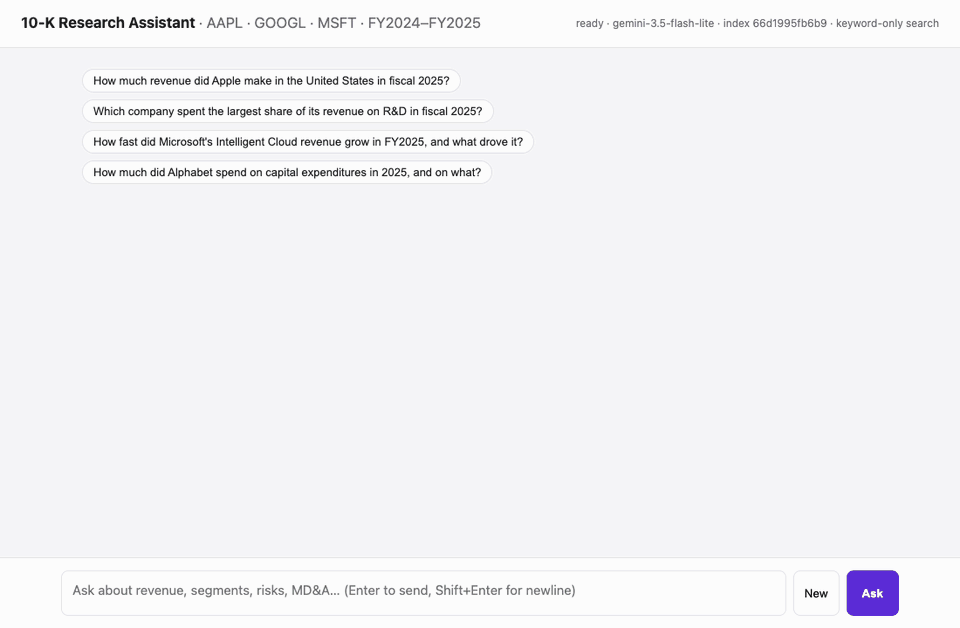
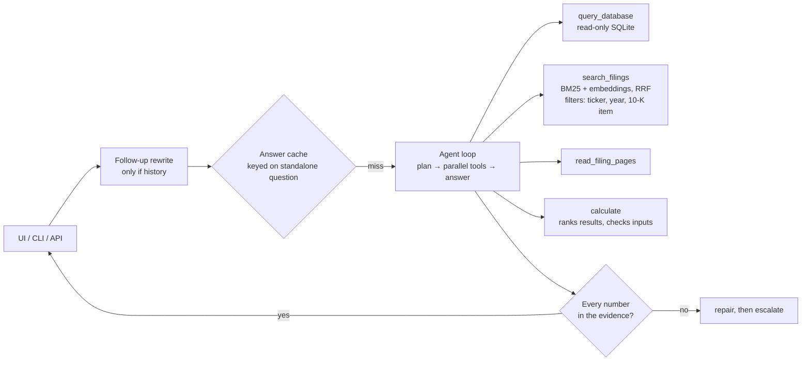

# Financial Audit RAG

An agentic research assistant for 10-K filings. It answers analyst questions by querying a database of annual financials, searching the companies' 10-Ks page by page, or both. Every answer comes with citations, a check that each number appears in the evidence, and the agent's full trace. Apple, Microsoft and Alphabet (FY2024–FY2025) ship with the repo, and [any other public company](#add-any-company) can be added from its 10-K. It runs on any OpenAI-compatible model provider, including a local server such as Ollama.

**Try it for free:** all you need is a free Google Gemini API key (no credit card). See [Quick start](#quick-start).



| | |
|---|---|
| Accuracy | 48/48: my 16 questions × 3 runs |
| FinanceBench | 125/150 (83%) on the public benchmark of analyst questions about real filings |
| Cost | ~$0.0008 per question |
| Latency | p50 2.0–2.7 s, p95 3.2–5.6 s |
| Throughput | One process served 50 concurrent users at 100% success, 331 answers/min |

Measured with `gpt-oss-120b` on a hosted serverless provider in October 2026, except FinanceBench, which ran on Gemini's free tier (`gemini-3.5-flash-lite`). Details in [Evaluation](#evaluation).

## Quick start

You need Python 3.11+, [uv](https://github.com/astral-sh/uv), and an API key for a model. A free Google Gemini key works and takes about a minute to get.

1. **Get a free API key.** Go to [aistudio.google.com/apikey](https://aistudio.google.com/apikey), sign in with a Google account, and click **Create API key**. No credit card is needed.
2. **Install, and paste the key into `.env`.**
   ```bash
   git clone https://github.com/madhavrajk/financial-audit-rag.git && cd financial-audit-rag
   uv sync
   cp .env.example .env   # then open .env and paste your key after LLM_API_KEY=
   ```
3. **Run it.**
   ```bash
   uv run python -m app.api.server   # UI and API on http://localhost:8000
   ```
   Open http://localhost:8000 and click an example question. If anything is missing, the page tells you exactly what to fix.

Gemini's free tier allows only a few requests per minute, and a question takes about three, so if you ask several questions in a row the app pauses until the limit resets. Google may use free-tier requests to improve its products. Most numbers above come from `gpt-oss-120b`. To use that model, or any other provider, see [Providers](#providers).

The data ships with the repo: the six 10-K PDFs, a prebuilt page index embedded with Qwen3-Embedding-8B, and `data/financials.db`, annual financials that the ingest code builds from the three companies' FY2025 10-Ks (income statements FY2023–FY2025, balance sheets FY2024–FY2025, revenue by segment and region). Point `EMBED_MODEL` at Qwen3-Embedding-8B on any provider to use the index as is. Without `EMBED_MODEL`, search is keyword-only (BM25). For a different embedding model, rebuild the index with `uv run python -m app.ingest`.

| Interface | How |
|---|---|
| Web UI (answer, evidence, trace, cost) | http://localhost:8000 |
| API | `POST /api/chat` with `{"question": "..."}`, plus optional `history` (`{role, content}` turns for follow-ups) and `session_id`. Send `Accept: text/event-stream` for SSE progress events. |
| CLI | `uv run python -m app.cli` (multi-turn) or `uv run python -m app.cli "question"` |
| Docker | `docker compose up --build` |
| Health | `/healthz` (liveness), `/readyz` (DB, index and provider settings, with reasons if not ready) |

### Providers

Any OpenAI-compatible API with tool calling works. To switch providers, comment out the three Gemini lines in `.env` and uncomment another block from [.env.example](.env.example).

| Provider | Cost | Where to get a key | `LLM_MODEL` |
|---|---|---|---|
| Google Gemini (default) | Free tier | [aistudio.google.com/apikey](https://aistudio.google.com/apikey) | `gemini-3.5-flash-lite` |
| OpenRouter | About $0.001 per question | [openrouter.ai/keys](https://openrouter.ai/keys) | `openai/gpt-oss-120b`, the benchmark model |
| OpenAI | Paid | [platform.openai.com/api-keys](https://platform.openai.com/api-keys) | `gpt-5-mini` |
| Ollama | Free, runs on your machine | No key needed | `gpt-oss:120b`, a ~65 GB model that needs a large machine |

Google retires Gemini models often. If requests fail with "no longer available", set `LLM_MODEL` to a current Flash-Lite model from Google's [model list](https://ai.google.dev/gemini-api/docs/models).

### Add any company

Open the company's 10-K on [sec.gov](https://www.sec.gov/edgar/search/), open the 10-K document itself (its address ends in `.htm`; if it starts with `sec.gov/ix?doc=`, delete `ix?doc=`), and save it with Cmd-S / Ctrl-S. Then:

```bash
uv run python -m app.ingest add ~/Downloads/nvda-20250126.htm
# Nvidia Corp (NVDA) FY2025 10-K: 87 pages; financials FY2023-FY2025 (3 income, 2 balance-sheet, 6 segment and 15 region rows)
```

The filing's pages join the search index, and its annual financials (statement lines, plus revenue by segment and by region) go into the database. Both come from the filing itself: a 10-K tags every number in its statements with inline XBRL, so no separate data feed is needed. The bundled database is built the same way, from the three companies' FY2025 10-Ks: `uv run python -m app.ingest database aapl-20250927.htm goog-20251231.htm msft-20250630.htm`.

The tools, prompt and UI are built from whatever is loaded, so a new company is immediately available to ask about. With NVIDIA and Amazon added, "Compare NVIDIA's and Amazon's revenue growth in their most recent fiscal year, and which segment drove each" is answered from the new filings in 8 s, with every number grounded.

To download filings by ticker instead (`add NVDA AMZN`), set `SEC_USER_AGENT` to a contact name and email; SEC rejects automated requests without one.

### Configuration

Settings come from environment variables or `.env`.

| Variable | Default | Purpose |
|---|---|---|
| `LLM_BASE_URL` | `https://api.openai.com/v1` | Any OpenAI-compatible endpoint |
| `LLM_API_KEY` | (none) | Not needed for local servers |
| `LLM_MODEL` | (required) | Agent model, as your provider names it |
| `EMBED_MODEL` | (off: BM25 only) | Embedding model for search |
| `EMBED_BASE_URL` / `EMBED_API_KEY` | the LLM's | Embeddings can come from a different provider |
| `ESCALATION_MODEL` | (off) | Stronger model, used only if the grounding repair fails |
| `JUDGE_MODEL` | `LLM_MODEL` | Evals only; a different model family is better |
| `MODEL_PRICES` | built-in table | Per-model prices for cost tracking, as JSON |
| `MAX_STEPS` / `MAX_REQUEST_TOKENS` | `8` / `120000` | Tool-loop step budget / per-request token cap |
| `SEC_USER_AGENT` | (none) | Only for `ingest add TICKER`: the contact SEC requires |

## Testing

Offline, with no API key and no cost:

```bash
make check   # ruff, pyright, tests, pip-audit
make test    # tests only
```

The tests run the real agent loop, tools, SQL guard and HTTP API against the real database and a keyword index built from the PDFs, with a scripted fake LLM in place of the model.

With a real model, once `.env` has a key (the free Gemini key from [Quick start](#quick-start) works):

```bash
curl -s localhost:8000/readyz                       # with the server running: ready, or what's missing
uv run python -m app.cli "How much revenue did Apple make in fiscal 2025?"
uv run python -m eval.run_eval                      # the 16 scored questions (--runs 3 to repeat)
uv run python -m eval.retrieval                     # BM25 vs dense vs hybrid recall
uv run python -m eval.financebench download         # then: index, run, grade, report
uv run python -m eval.judge_agreement sample        # then: label (you), report
```

The CLI should answer $416.2 billion, call `query_database`, and report every number as grounded. Eval reports go to [eval/results/](eval/results). `--no-judge` skips the LLM-judged questions. The `gpt-oss-120b` runs used hybrid search, the free-tier runs keyword-only search. Each question makes several model calls, so on Gemini's free tier a full benchmark can run into the daily request limit; the FinanceBench steps save after every question and resume where they stopped. To load-test, follow the instructions at the top of [eval/load_test.py](eval/load_test.py).

## How it works



The model picks tools through native function calling. For multi-part questions it writes a short plan, then makes the tool calls in parallel.

| Tool | Does | Why |
|---|---|---|
| `query_database` | One read-only SELECT | Exact, cheap numbers. The schema and every segment and region name are in the prompt. |
| `search_filings` | Hybrid search over pages, filtered by company, year and 10-K item (`1A` risks, `7` MD&A, `8` notes) | Explanations, risks, and numbers found only in the filings (YouTube ads, Azure growth, iPhone sales) |
| `read_filing_pages` | Up to 3 consecutive pages | Tables and paragraphs that continue onto the next page |
| `calculate` | Several labelled expressions per call; returns a ranking and warns if an input isn't in the evidence | The model mis-compared and mis-typed numbers in evals |

**Retrieval.** The unit is one PDF page with its layout preserved. PyMuPDF's default extraction puts "YouTube ads" about 10 lines away from "36,147", while `sort=True` keeps the row together (`YouTube ads | 36,147 | 40,367`). Each page is tagged with its 10-K items and embedded with a header such as "GOOGL FY2025 10-K · Item 7 MD&A · page 36". BM25 and embedding results are merged with Reciprocal Rank Fusion. Without embeddings, search falls back to BM25 and the trace says so.

**Grounding.** Every number in the answer must appear in the evidence: tool outputs, calculator results, or the question. Matching is unit-aware ($36.1B matches 36,147 in millions) and precision-aware ($1.5B must round from the evidence). A failed check gets one repair round, then one attempt on the escalation model. Anything still unsupported is returned in `grounding.unsupported`. Filings print their own page numbers, which differ from the page labels (PDF page 38 of Microsoft's 10-K prints "39"), so a citation of a printed number is mapped to the page that was read, and the trace records it.

**Data dictionary.** The system prompt documents each data quirk that would otherwise silently change answers:
- Alphabet: segment and region rows leave out hedging gains (losses), a small reconciling item, so they don't sum exactly to total revenue. `gross_profit` is NULL, and operating expenses include cost of revenue (Apple's and Microsoft's don't).
- Apple: its reportable segments are geographic (Americas, Europe, Greater China, Japan, Rest of Asia Pacific), and the Americas are not the U.S. Revenue by product (iPhone, Services) is only in the filings.
- Microsoft: the database uses the segments restated in August 2024, while the FY2024 10-K shows the old ones (Intelligent Cloud: $105.4B as originally reported vs $87.5B restated).
- Fiscal years end in September (Apple), June (Microsoft) and December (Alphabet). The database covers FY2023–FY2025 (balance sheets FY2024–FY2025), the filings FY2024–FY2025. NULL means a filing doesn't report that line for that year (Alphabet's FY2024 total debt).

## Evaluation

The question set ([eval/questions.json](eval/questions.json)) has 16 questions I wrote, with gold answers, aimed at the data quirks above and at out-of-scope questions. Each question has one scorer ([eval/scorers.py](eval/scorers.py)):
- a numeric match within 1%, after normalizing units
- the correct company named first, plus its number
- an LLM judge from a different model family, with a fixed rubric
- a refusal check

The harness also tracks routing, unsupported numbers, latency, tokens and cost. Evals bypass the answer cache. All result files are in [eval/results/](eval/results).

Final system with `gpt-oss-120b`, hybrid search and a `kimi-k3` judge, 3 runs on prompt v6:

| | Run 1 | Run 2 | Run 3 |
|---|---|---|---|
| All 16 questions | 16/16 | 16/16 | 16/16 |
| Answers with unsupported numbers | 0 | 0 | 0 |
| p50 / p95 latency | 2.7 / 5.6 s | 2.3 / 3.2 s | 2.0 / 3.8 s |
| $/question | $0.0009 | $0.0007 | $0.0007 |

These runs used an earlier version of the database. The current one is built from the filings' inline XBRL by the same code that [adds companies](#add-any-company), and its income-statement and balance-sheet values are identical. Prompt v9 is generated from the loaded data instead of being written for three companies, and describes the rebuilt database. Re-run on the free tier, with `gemini-3.5-flash-lite`, keyword-only search and a `gemini-3.1-flash-lite` judge, it answered 15 of 16 correctly, with 0 unsupported numbers ([results](eval/results/gemini-3.5-flash-lite_20261029-120632.md)). The 16th, Apple's current ratio, hit the 180-second request limit while waiting out rate limits; re-run with a longer limit, it was answered correctly ([re-run](eval/results/gemini-3.5-flash-lite_20261029-134919.md)). Free-tier latency is mostly waiting out rate limits, so it isn't comparable.

Each change came from a failure found in the evals (accuracy on these questions; the 16th was added in v6):

| Version | Accuracy per run | Failure | Change |
|---|---|---|---|
| v1 | 12/15 (1 run) | Named Apple fastest-growing although its own calculation had Alphabet ahead (32.0% vs 19.5%); declined without calling a tool | Calculator returns a ranking; check with tools before declining |
| v2 | 14 / 14 / 14 of 15 | Typed a number from a filing into the calculator with one digit wrong. Answer-level grounding passed it, because the wrong number was the calculator's own output. | Calculator inputs are checked against the evidence inside the loop |
| v3 | 13 / 14 / 13 of 15 | Read Intelligent Cloud's operating-income row ($49.6B) as its revenue; left out compared values | Prompt: give every compared value, label years, confirm the table block |
| v4 | 15 / 15 / 15 of 15 | Another model exposed a wrong gold label: Apple's 10-K notes do disclose U.S. net sales | Label fixed; check filing notes before declining |
| v5 | 15 / 15 / 15 of 15 | An out-of-scope question (Apple's FY2021 revenue) triggered 15 searches: 310k tokens, 38× the median | Hard per-request token budget; explicit data boundary in the prompt |
| v6 | 16 / 16 / 16 of 16 | | Final version |

Model comparison (one run each, no escalation; the last two ran on the final prompt):

| Model | Accuracy | p50 | $/question |
|---|---|---|---|
| gpt-oss-120b (default) | 15/15 ×3 | 2.1–3.0 s | $0.0007–0.0010 |
| deepseek-v4p1-flash | 15/15 | 6.5 s | $0.0022 |
| minimax-m3 | 15/15 | 3.3 s | $0.0017 |
| glm-5p3 | 15/15 | 7.3 s | $0.0074 |
| kimi-k3 | 14/15 | 15.4 s | $0.0230 |
| nemotron-lightning-3p5-30b-a3b | 14/16 | 4.0 s | $0.0008 |
| glm-5p3-flash | 14/16 | 5.7 s | $0.0010 |

- Strong models saturate this set, so the default was chosen on cost and latency.
- Cheaper tokens don't mean cheaper answers. Nemotron's tokens cost a third as much as gpt-oss-120b's, but it used 2.1× the input and 5× the output tokens, so its answers cost the same.
- Kimi K3's one "miss" was actually correct; it led to the v4 label fix. glm-5p3-flash answered the out-of-scope Amazon question with Alphabet's revenue, and Nemotron gave up on an answerable question (its other miss is a refusal worded in a way the scorer doesn't recognize).
- For models used only as the agent, logged usage matched the provider's bill within 0.4%. The whole project, including every eval run and model comparison, cost about $3.75.

### FinanceBench

[FinanceBench](https://github.com/patronus-ai/financebench) is a public benchmark of 150 questions written by financial analysts about 84 real filings from 32 companies (10-Ks, 10-Qs, 8-Ks and earnings releases), with reference answers and evidence pages. [eval/financebench.py](eval/financebench.py) downloads the filings, puts all of them in one index (12,013 pages, no database), runs every question through the unchanged agent, and grades the answers with the same judge rubric.

One run on the free tier, with `gemini-3.5-flash-lite`, keyword-only search, prompt v8 and a `gemini-3.1-flash-lite` judge ([report](eval/results/financebench_gemini-3.5-flash-lite.md)):

| | |
|---|---|
| Correct | 125/150 (83%) |
| Metrics questions (ratios from the statements) | 47/50 |
| Domain questions ("is 3M capital-intensive?") | 40/50 |
| Novel questions (written per document) | 38/50 |
| An analyst's evidence page among the pages the agent read | 122/150 (81%) |
| Right document | 141/150 (94%) |
| Answers with unsupported numbers | 0 |

The FinanceBench paper (Islam et al., 2023) reports that GPT-4-Turbo with a retrieval system "incorrectly answered or refused to answer 81% of questions". That comparison is loose: the paper graded by hand with 2023 models, while this run was graded by an LLM judge from the agent's own model family. Some of the judge's failures look like the judge's or the reference's mistakes, not the agent's: a reference that flips the signs of Boeing's tax rates, and a correct 1.46% return on assets failed for not being written as "0.01". The rest are mostly judgment calls (whether 3M is capital-intensive), ratios computed with different definitions, and searches that missed the right page.

The agent reads the top 3 pages of each search. A reranker would cost more per question than the LLM, for little gain, so there isn't one.

## Design decisions

| Decision | Chosen | Rejected |
|---|---|---|
| Orchestration | One tool-calling loop with a plan step | Router with fixed pipelines (brittle on mixed questions); planner/executor graph (more latency and failure points); LangChain (harder to debug, more dependencies) |
| SQL | Model-written SQL; the database enforces read-only access | Fixed metric functions, which can't anticipate new questions |
| Retrieval unit | Layout-preserved page | Chunks (split tables); whole filings in context (65–70k tokens each) |
| Search | In-memory BM25 and numpy vectors, fused with RRF | Vector database: 2 MB of vectors, exact search under 5 ms |
| Arithmetic | The `calculate` tool | Model arithmetic, which failed twice in evals |
| Hallucination control | Deterministic grounding check, then repair, then escalation | LLM self-critique: an extra call per answer, and no better at checking numbers |
| Caching | Exact cache on the standalone question, plus the provider's prompt-prefix cache (~64% of prompt tokens cached) | Semantic cache: "Apple revenue FY2024" and "FY2025" embed almost identically, and a false hit is a wrong number |

Reliability and security:
- Bad or unknown tool calls go back to the model as errors. Repeated identical calls are short-circuited, and hitting the step or token budget forces an answer from the evidence so far.
- Model calls are retried only on 429s, 5xx errors and timeouts, waiting as long as the provider asks (a Retry-After header, or "retry in 20s" in the error text, as Gemini sends it). A wait over a minute, such as a daily quota, fails at once with the provider's own message. An adaptive (AIMD) limiter backs off when the provider rate-limits. If embedding fails, search falls back to keywords, and a client disconnect cancels in-flight model calls.
- The database is read-only in three ways (`mode=ro`, `query_only`, and an authorizer that allows only reads), with a row cap and a timeout. The calculator parses expressions with `ast` and never calls `eval`.
- The server binds to localhost, limits CORS to localhost, rate-limits each client, caps input sizes, and inserts model output with `textContent`. Filing text is treated as data, not instructions. The container runs as non-root on a read-only filesystem.

## Scaling

The agent depends only on interfaces ([app/core/ports.py](app/core/ports.py)), wired together in [app/container.py](app/container.py), so each scale-up is a new adapter rather than a rewrite:

| State | Now | At scale |
|---|---|---|
| Page index | Loaded into memory at startup | Qdrant or pgvector past ~1M pages |
| Financials | Read-only SQLite | Postgres read replica |
| Answer cache | In-process TTL/LRU | Redis, once there's more than one replica |
| Traces | JSONL and stdout | OpenTelemetry |

Load test ([eval/load_test.py](eval/load_test.py)), one process with the answer cache off:

| Concurrent users | Success | Answers/min | p50 | p95 |
|---|---|---|---|---|
| 1 | 100% | 22 | 2.4 s | 3.1 s |
| 10 | 100% | 132 | 2.9 s | 4.8 s |
| 25 | 100% | 272 | 2.8 s | 6.7 s |
| 50 | 100% | 331 | 4.7 s | 8.2 s |
| 100 | 76% (the rest got 503 + Retry-After) | 107 | 32.9 s | 60.4 s |

Fixed concurrency limits failed in both directions. With 8 calls in flight, throughput plateaued at ~125 answers/min. With 32, the server overran the provider's rate limit and 54% of requests failed at 50 users. The AIMD limiter fixed both. The bottleneck was the provider's output-token rate limit, not the server, so shorter outputs and lower reasoning effort raise capacity and cut cost.

## Limitations

- Grounding checks that a number appears in the evidence, not that it belongs to the right company or year. Citations are corrected only for printed page numbers; a citation of the wrong page is not otherwise caught.
- I wrote the 16-question set, so it shares my blind spots, and strong models saturate it. FinanceBench's 150 analyst-written questions are the harder test, but so far with one run of one free model.
- The LLM judge's agreement with human graders wasn't measured, and the FinanceBench judge comes from the agent's own model family.
- The load test ran on one laptop. The model comparison used one run per model, on a prompt tuned for gpt-oss-120b.
- Data-quirk notes exist only for the three bundled companies. Added companies get standard-concept financials from their filings, and any quirks in those go unexplained to the model. Breakdowns that a filing doesn't tag as a segment or region (product lines, reconciling items) stay in the filing text.

## Project layout

```
app/core/      agent loop, prompts (built from the loaded data), grounding check, ports, config
app/tools/     tool schemas (generated from Pydantic, with the loaded companies as enums), calculator
app/adapters/  OpenAI-compatible LLM and embeddings, read-only SQLite, hybrid index, cache, traces
app/ingest/    PDF or EDGAR HTML → pages; inline XBRL → financials; `add`; incremental, atomic index
app/api/       FastAPI server (JSON and SSE) and the single-file UI
app/service.py request handling shared by the API, CLI and evals
eval/          eval harness, scorers, questions, FinanceBench, judge agreement, results/
tests/         offline tests with a scripted LLM
data/          financials.db, 10-K PDFs, filings you add, prebuilt page index
docs/          demo.gif
```
